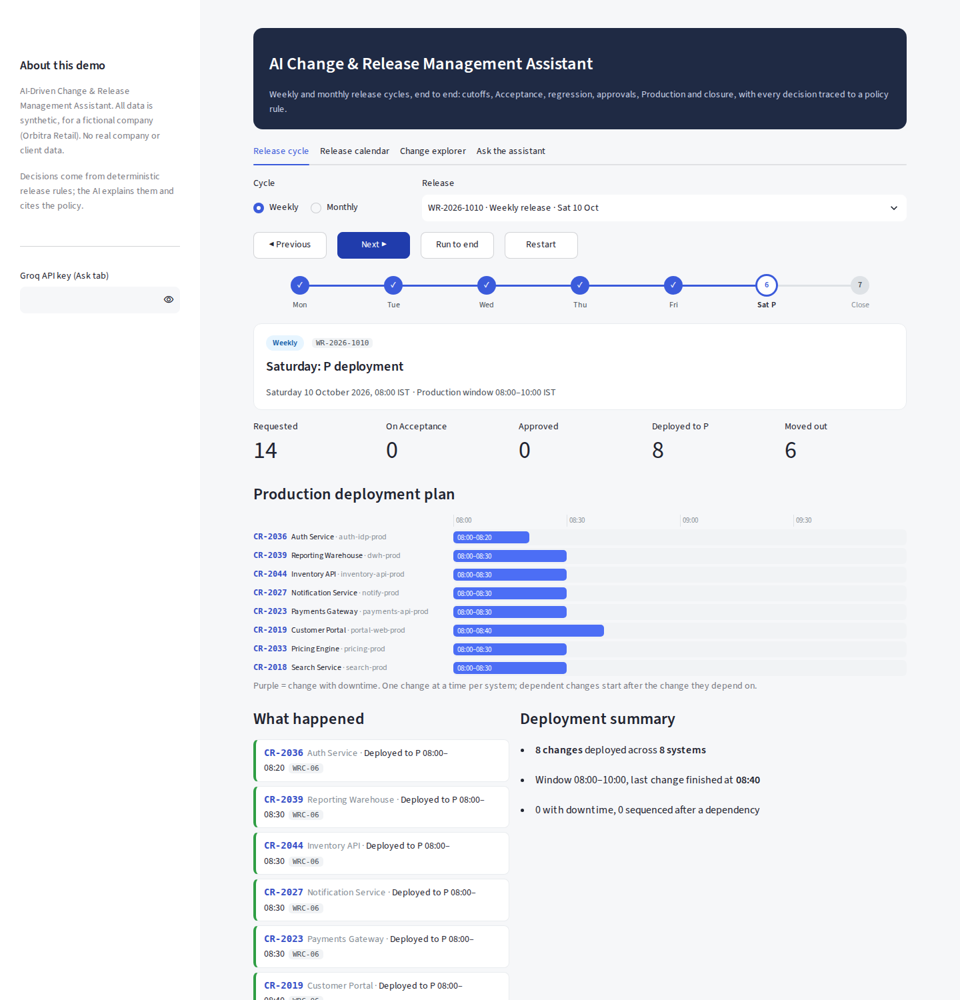
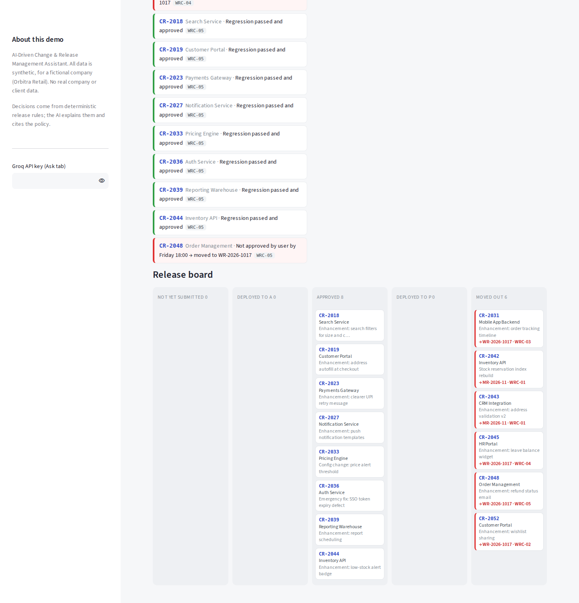
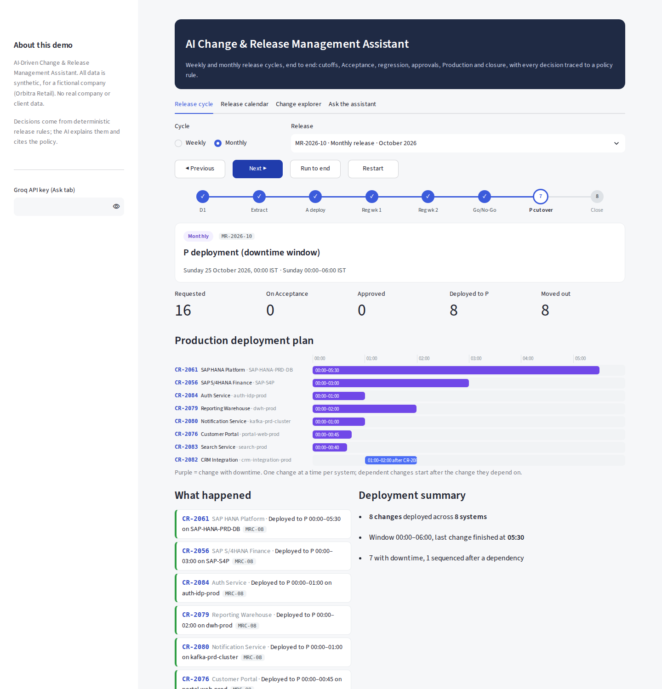
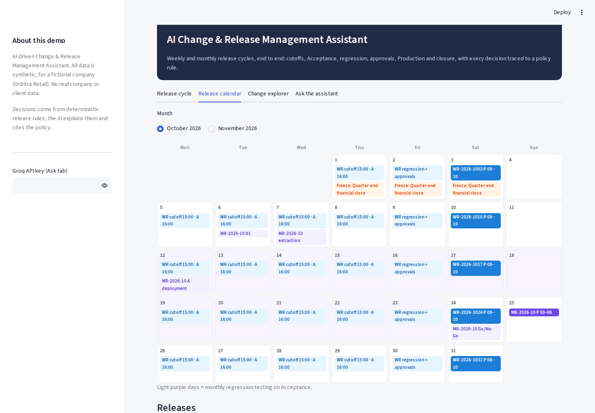
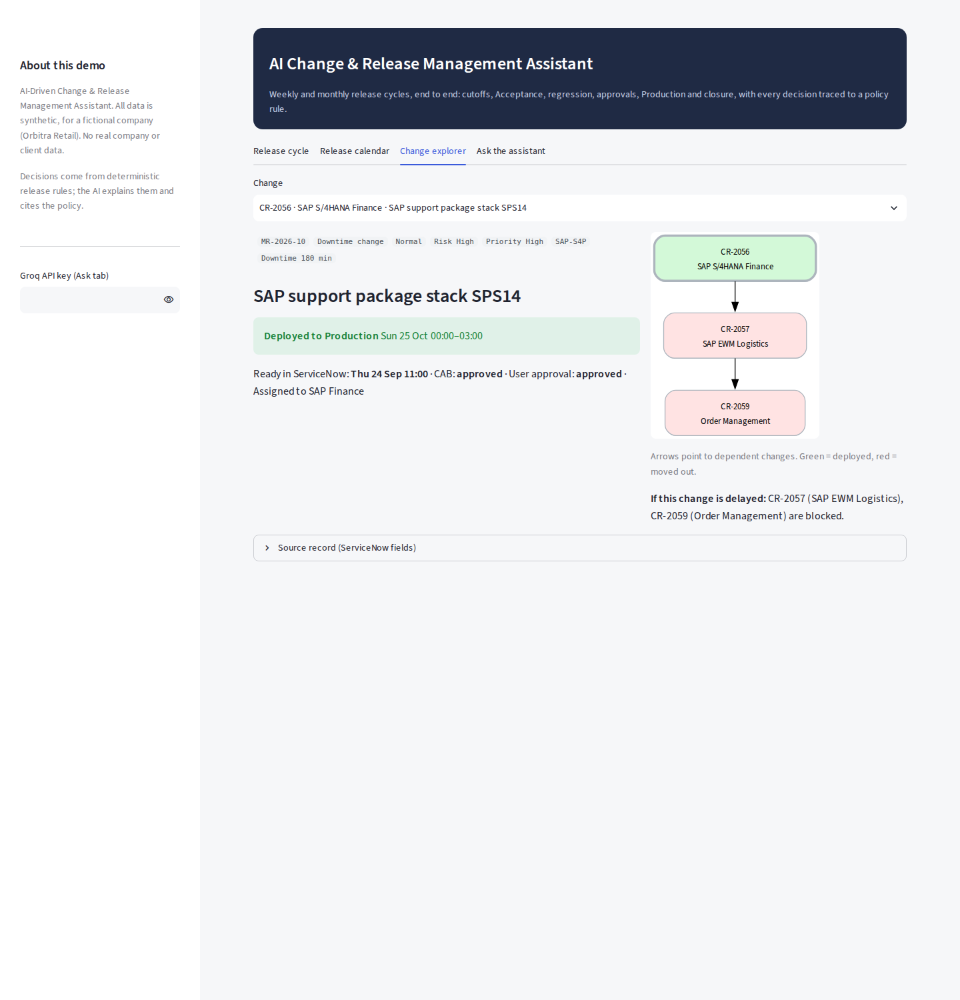
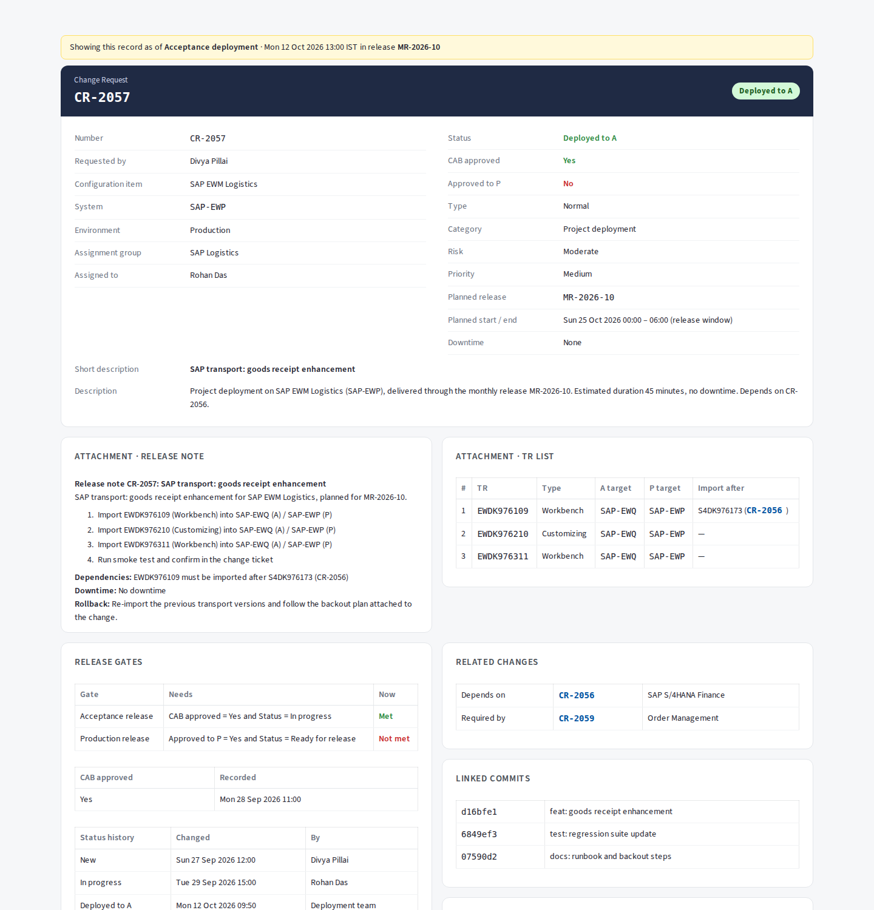
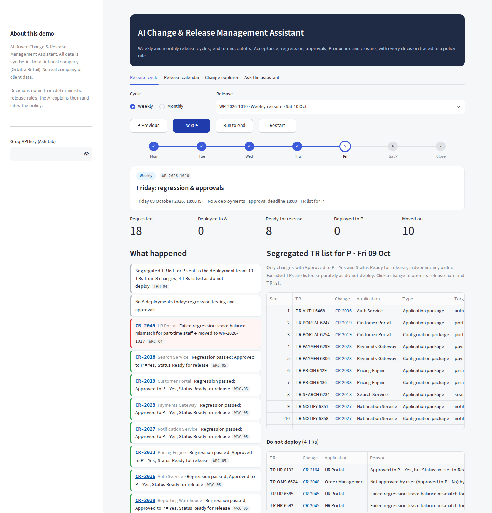
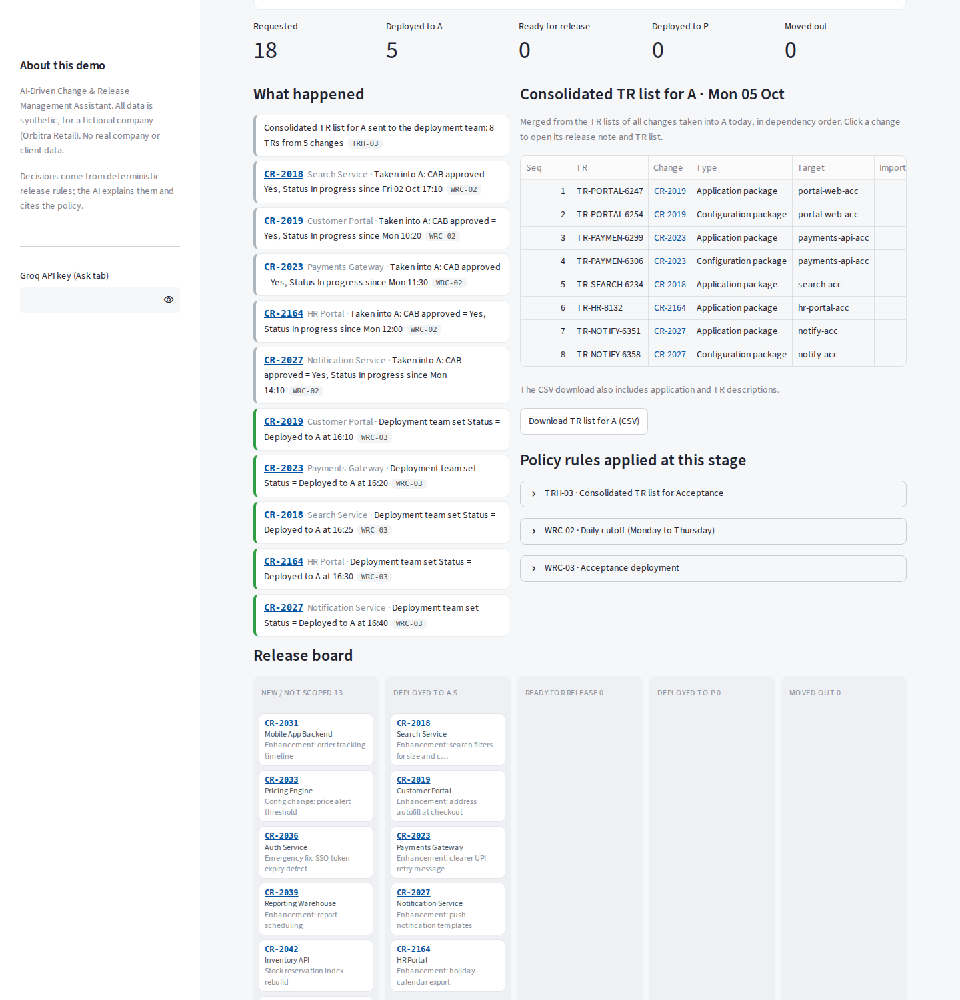
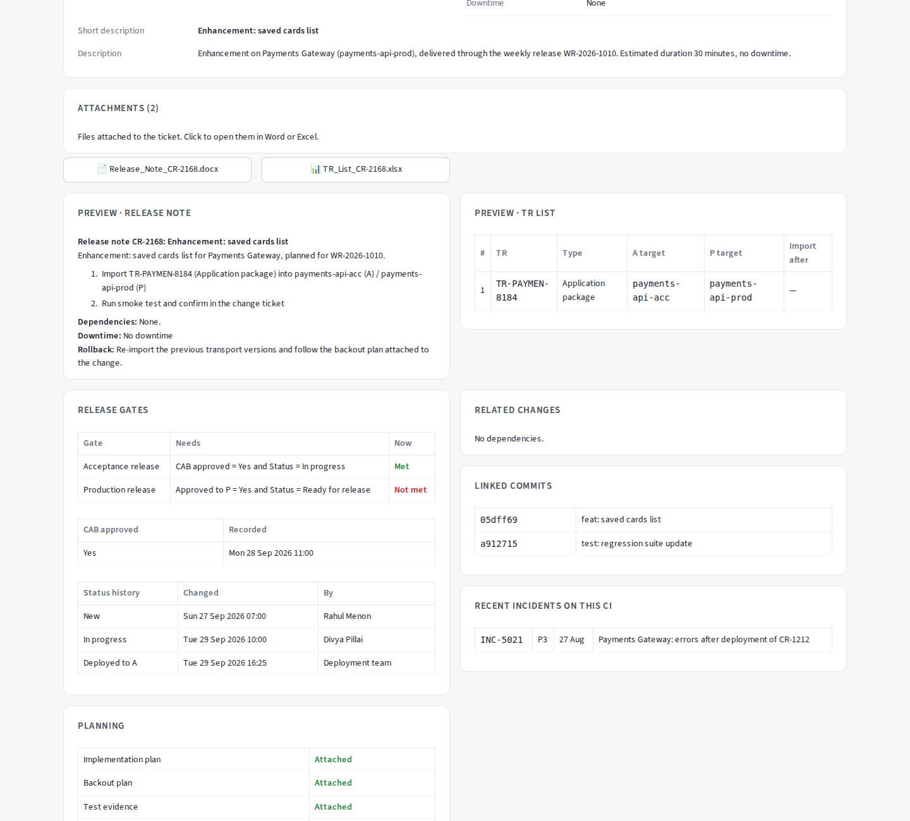

# Release Management Assistant

An AI-assisted release management workbench that models how weekly and monthly software releases are planned, checked and cut over. It combines a Streamlit app, a change and release data model, written release policies, and an assistant that answers questions about changes and releases using those policies.

> **All data in this repository is synthetic**, generated for a fictional company by `scripts/generate_mock_data.py`. It contains no employer or client data.

## What it does

- **Weekly and monthly release cycles:** models the cutoffs, Acceptance, regression, approvals and the Production window for each cycle, with Friday, Saturday and Monday views.
- **Release calendar:** shows releases, freeze windows and cutover dates in one place.
- **Change explorer and change record page:** browse change requests, open a single change and see its risk, approvals, dependencies and attachments.
- **TR lists:** produces the transport request lists used in the weekly Friday and Monday steps.
- **Policy-grounded assistant:** answers release and change questions from the written policies in `policies/` (change types and lead times, CAB process, freeze rules, emergency changes, risk and testing, backout and rollback, release notes, dependencies and downtime, weekly and monthly cycles).
- **Deployment tooling hooks:** `release_assistant/deploy_tools.py` holds the deployment-related helpers the assistant can call.

## Screenshots

| Weekly release, Saturday | Weekly release, Friday board |
|---|---|
|  |  |

| Monthly cutover | Release calendar |
|---|---|
|  |  |

| Change explorer | Change record |
|---|---|
|  |  |

| TR list, Friday | TR list, Monday |
|---|---|
|  |  |

| Change attachments |
|---|
|  |

## Project structure

```
.
├── app.py                      # Streamlit entry point
├── record_page.py              # Single change record view
├── release_assistant/
│   ├── assistant.py            # Policy-grounded assistant
│   ├── cycles.py               # Weekly and monthly cycle logic (cutoffs, windows)
│   ├── release_calendar.py     # Calendar and freeze-window logic
│   ├── data.py                 # Loads the JSON data files
│   ├── attachments.py          # Change attachment handling
│   └── deploy_tools.py         # Deployment helper functions
├── data/                       # Synthetic changes, releases, incidents, freeze windows
├── policies/                   # Written release and change policies (Markdown)
├── scripts/
│   └── generate_mock_data.py   # Regenerates the synthetic data
├── tests/
│   └── test_cycles.py          # Tests for the cycle logic
├── docs/screenshots/           # Screenshots used in this README
├── DEMO_GUIDE.md               # Walk-through script for demoing the app
└── requirements.txt
```

## Getting started

**Requirements:** <FILL: Python version, e.g. 3.11+>

```bash
git clone https://github.com/MadhuriRavindra/release-management-ai-assistant.git
cd release-management-ai-assistant

python -m venv .venv
source .venv/bin/activate        # Windows: .venv\Scripts\activate
pip install -r requirements.txt
```

**Configure secrets**

```bash
cp .streamlit/secrets.toml.example .streamlit/secrets.toml
```

Open `.streamlit/secrets.toml` and add <FILL: the key(s) the assistant needs, e.g. your LLM provider API key>. This file is git-ignored, so your key is never committed.

**Run the app**

```bash
streamlit run app.py
```

## Synthetic data

The weekly and monthly demo scenarios are scripted so the walk-through is the same every time; the remaining releases are randomised. To regenerate the data:

```bash
python scripts/generate_mock_data.py
```

## Tests

```bash
pytest
```

## Demo

`DEMO_GUIDE.md` has a step-by-step script for presenting the app, including the questions to ask the assistant and what to expect.

## Design principles

- **Swap-ready:** the data layer is isolated in `release_assistant/data.py`, so the synthetic JSON files can be replaced by a live change-management source (for example the ServiceNow Table API) without restructuring the rest of the code.
- **Fail loudly:** missing configuration raises a clear error instead of failing silently.
- **Policy-grounded answers:** the assistant answers from the written policies in `policies/` instead of inventing rules.

## Roadmap

- Multi-agent extension (orchestrator with Risk, Dependency, RAG and Release Summary agents) for AI-driven risk assessment and release summaries. *Planned, not yet implemented.*
- Connect to a live change-management source in place of the synthetic data.
- Cloud deployment of the demo.

## Tech stack

Python, Streamlit, <FILL: LLM provider and model>, JSON data store, pytest.

## License

<FILL: e.g. MIT, or remove this section>